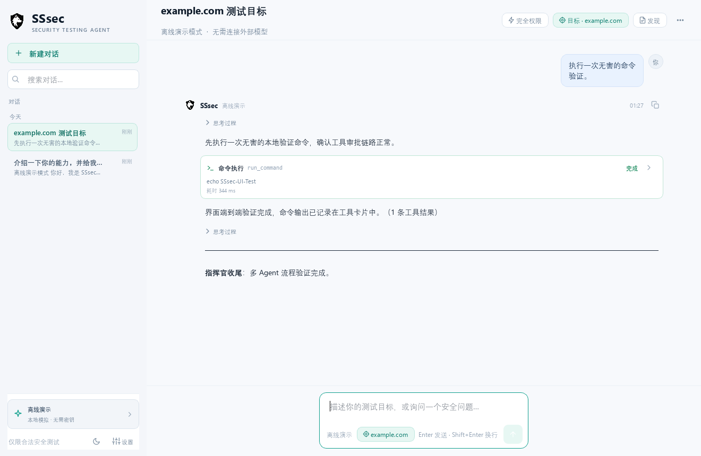
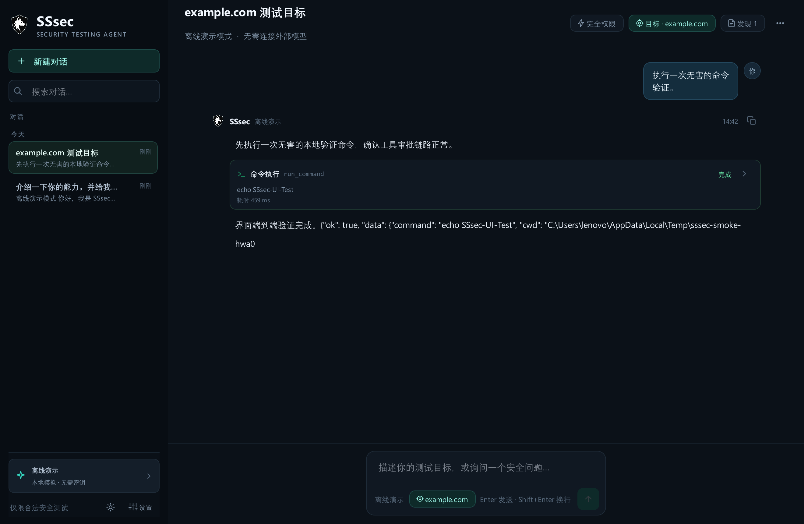
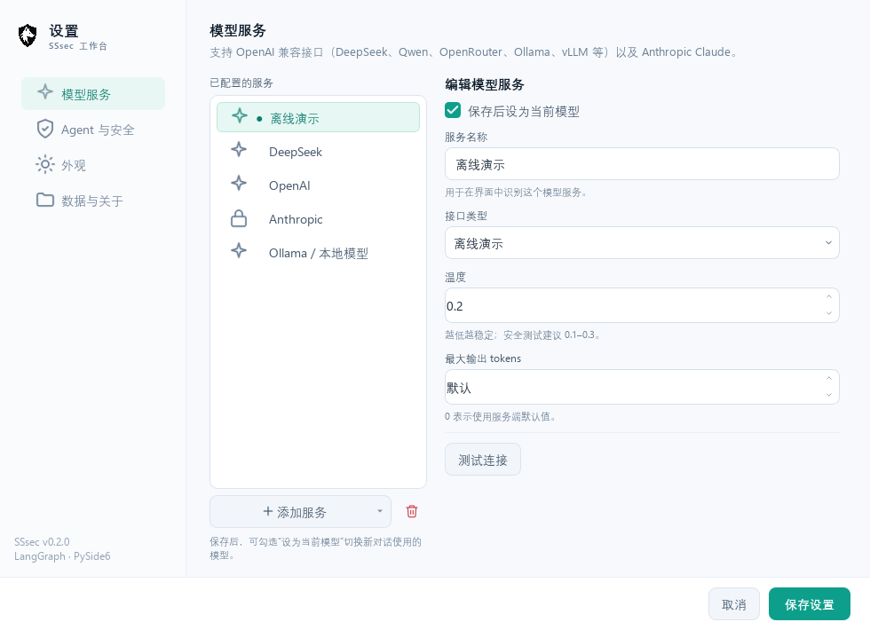
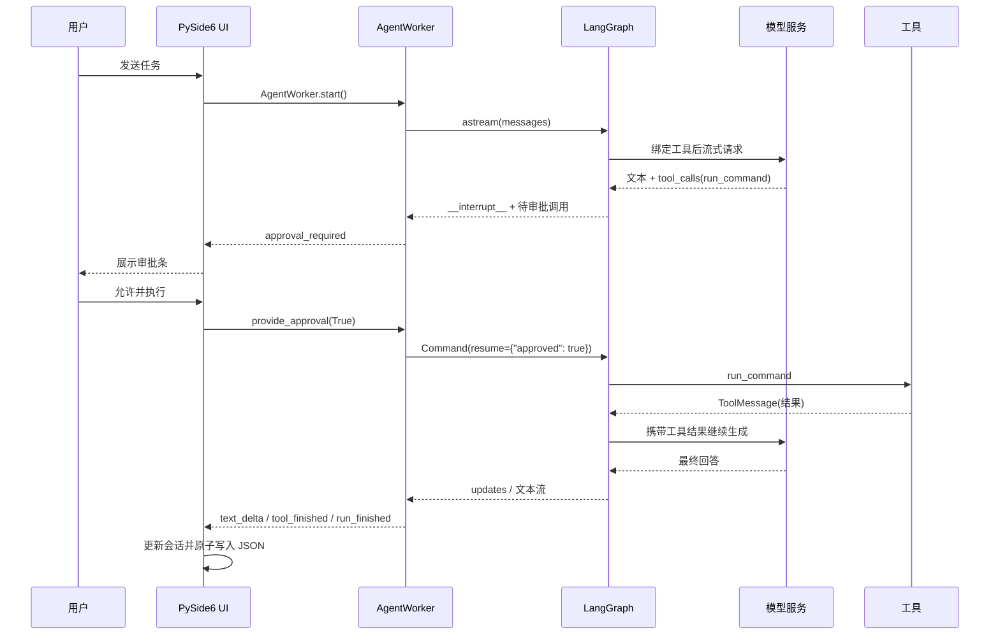
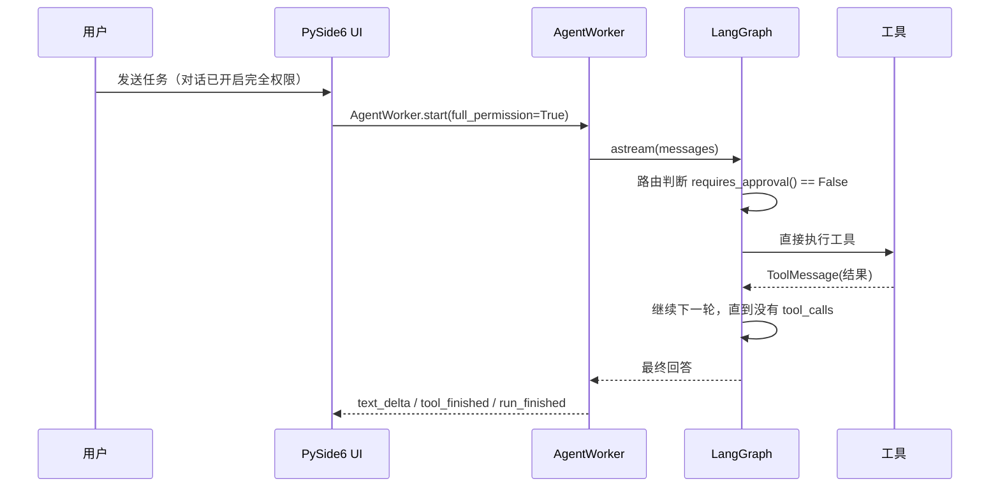

# SSsec

> **SSsec** 是一个面向授权安全测试的本地桌面 AI Agent Harness。
> 界面使用 **PySide6**，Agent 运行时基于 **LangGraph + LangChain**，模型服务、对话、工具调用、权限策略与审计全部围绕桌面工作流设计。

**当前版本：v0.2.0** · 默认浅色主题 · 指挥官 + 阶段子图多 Agent


---

## 版本说明

### v0.2.0（当前版本）

v0.2.0 在 v0.1.0 的桌面 Agent 闭环之上，完成了以**多 Agent、CTF/SRC 工具链、DeepSeek thinking 兼容、可控轮次预算**为核心的升级：

- **指挥官 + 四阶段子图**：`commander → recon / vuln_analysis / exploit / post_exploit → report → commander`；
- **37 个工具**：按信息收集、漏洞分析、漏洞利用、后渗透、逆向拆分，不再让所有 Agent 绑定同一套通用工具；
- **reverse 专项 Agent**：对 ELF/PE/固件做 `binary_info` + `disassemble` + 本地求解；
- **final 最终突破 Agent**：前序信息只作线索，全部工具、20 轮，重新完整思考；
- **默认宽松审批**：只读/分析工具直接执行，仅明显高风险命令与有副作用工具需要确认；
- **DeepSeek thinking 支持**：保留并回传 `reasoning_content`，修复 `reasoning_content must be passed back` 400；
- **tool-call 历史修复**：补齐缺失 ToolMessage、丢弃孤立 ToolMessage、阶段轮次上限自动收口，修复 `tool_calls must be followed by tool messages` 400；
- **轮次预算提升**：全局 12、阶段 6/6/8/6、指挥官 16、历史 60、LangGraph 递归默认 348；
- **TSEC SDK 连续跑分**：默认 360 分钟，按题轮转，后续轮次自动增加工具预算；
- **TSEC 混合模式**：第一遍单 Agent 快速覆盖，后续未解决题再交给多 Agent 深挖；
- **Windows 构建编码修复**：`build.ps1` UTF-8 BOM + `chcp 65001`，解决 PyInstaller 构建中文乱码；

---


## 1. 项目定位

SSsec 是一个**可切换权限、可审计的本地安全测试 Agent 工作台**：

- 你把测试目标、约束和任务描述交给它；
- 它通过模型规划步骤，并在需要时调用 HTTP、DNS、TCP、端口/目录/子域扫描、编码、Crypto/二进制/文件分析、命令执行、发现记录等工具；
- 敏感操作会在界面底部请求你的确认；
- 所有工具调用与审批决定写入本地审计日志；
- 你可以随时停止、切换对话、调整权限或主题。

### 适合谁

| 角色 | 典型用途 |
| --- | --- |
| 安全工程师 | 授权范围内的资产梳理、HTTP 安全头检查、DNS/端口连通性验证、过程留痕 |
| 渗透测试人员 | 在明确授权和测试窗口内做低影响验证，把命令执行与证据记录放在同一个工作台 |
| 安全专业学生 | 在本地实验环境学习 Agent 工具调用、审批流和审计设计 |
| 工具开发者 | 以现有工具、审批、范围、审计为骨架，扩展自己的安全测试能力 |

### 与通用聊天客户端的区别

| 能力 | 通用聊天客户端 | SSsec |
| --- | --- | --- |
| 工具调用 | 通常没有或不可控 | 分阶段工具集，按 Agent 白名单可见、可审批 |
| 权限 | 无 | 范围策略 + 审批策略 + 对话级完全权限 |
| 审计 | 无 | 每个对话独立 JSONL，记录参数与结果摘要 |
| 本地数据 | 可能在云端 | 会话、密钥、日志全部在本机 |
| 安全测试工作流 | 无 | 目标范围、测试发现、命令工作目录 |

> **授权是前提。** 目标范围是技术提示与审计标记，不是法律授权；使用前请确认你已获得目标所有者的明确许可，并遵守测试窗口、方法与当地法律。

---


## 2. 功能总览

### 2.1 界面与主题

- 三栏式桌面布局：左侧会话栏、中间聊天区、底部输入区；
- 浅色（白色主题）与深色（安全测试工作台）两套完整主题；
- 主题切换立即生效，主窗口会重建并保留输入草稿；
- 侧边栏支持会话搜索、重命名、删除、按今天/昨天/更早分组；
- 窗口大小、位置、上次打开的对话会保存；
- Windows 下标题栏颜色跟随主题（DWM）。

### 2.2 会话与权限

- 每个对话独立保存标题、目标范围、授权标记、完全权限、消息与测试发现；
- 目标范围支持域名、通配子域名、IP、CIDR、URL 与 `*`；
- 三种范围策略：`off`（默认不限制）、`warn`（仅提示）、`strict`（严格拦截）；
- 五种审批策略：宽松（默认）、仅敏感工具、所有工具、关闭审批、全局完全权限；
- 对话级“完全权限”可跳过审批并强制关闭范围拦截；
- 会话 JSON 原子写入，异常退出后会把半成品消息标记为中断。

### 2.3 模型接入

- OpenAI 兼容接口：DeepSeek、OpenAI、Qwen、Moonshot、OpenRouter、Ollama、LM Studio、vLLM 等；
- Anthropic Claude；
- 内置离线演示模型，不需要网络和 API Key；
- 每个服务可单独配置名称、模型 ID、Base URL、API Key、温度、最大输出 tokens；
- 内置“测试连接”，保存前可验证服务可用性；
- DeepSeek thinking 模型自动保留并回传 `reasoning_content`；
- API Key 在 Windows 上使用 DPAPI 加密后写入本地配置。

### 2.4 Agent 与安全

- **指挥官 + 阶段子图**：`commander → recon / vuln_analysis / exploit / post_exploit（可选 reverse）→ report → commander`；
- 指挥官只做路由，不持有工具；四个常规阶段 + `reverse` 专项各自拥有独立工具集与提示词；
- **37 个工具**按阶段拆分：信息收集、漏洞分析、漏洞利用、后渗透、逆向，每个 Agent 只绑定自己的白名单；
- 子图内部仍是 `agent → tools → agent` 循环，可通过 `handoff` 主动交接，也可由指挥官根据阶段报告决定下一步；
- **最终汇总突破 Agent（final）**：TSEC 在多次尝试仍失败后启用，拥有全部工具、20 轮，前序信息只作线索；
- 通过 `interrupt()` / `Command(resume=...)` 实现人工审批，子图的审批会冒泡到父图；
- 流式文本、思考过程、工具开始/完成事件通过 Qt Signal 回到界面；
- 默认“宽松审批”：只读工具与普通命令直接执行，仅明显高风险命令与有副作用工具需要确认；
- 工具输出截断、超时、端口数/轮次上限；
- 命令在会话独立工作目录中运行；保守模式逐条审批，宽松模式只拦高风险命令；
- 完全权限模式跳过审批，适合受控环境连续验证；
- 支持 DeepSeek thinking 的 `reasoning_content` 回传，并修复 tool-call 历史导致的 400。

### 2.5 本地数据与审计

- 会话：`conversations/<id>.json`；
- 审计：`audit/<id>.jsonl`，每行一个事件；
- 工作目录：`workspaces/<id>/`；
- 日志：`logs/sssec.log`，2 MB 轮转、保留 3 个备份；
- 配置：`config.json`，保存模型服务、主题与安全策略；
- 界面状态：`ui_state.json`，保存上次会话与窗口几何。

### 2.6 当前 Agent 运行模式

| 入口 | 图 | 说明 |
| --- | --- | --- |
| GUI 对话（CTF / SRC / AWD） | `team` | 指挥官 + 阶段子图；`reverse` 可选 |
| 离线演示模型 | `demo` | 单节点，无真实工具 |
| TSEC `--mode single` | `single` | 全部工具、任务级 16 轮、无指挥官 |
| TSEC `--mode team` | `team` | 同 GUI |
| TSEC `--mode final` | `final` | 全部工具、任务级 20 轮、汇总突破 |
| TSEC `--mode hybrid` | `single → team → final` | 默认：第 1 次 single、第 2～3 次 team、第 4 次起 final |

> **GUI 对话目前只走 `team`，不会自动走 single/hybrid/final。**  
> `single` 和 `final` 目前由 TSEC 无界面适配器调度。

---


## 3. 界面预览

### 启动页（默认浅色）


### 流式对话与 Markdown


### 工具审批（保守模式）


### 工具执行与结果



### 主题设置


### 深色主题



### 模型配置



### Agent 与安全策略


### 目标范围与完全权限


### 完全权限状态


### 测试发现


> 截图由 `scripts/ui_smoke.py` 在离屏环境中生成，使用临时数据目录，不会影响真实会话。

---


## 4. 技术架构

### 4.1 技术栈

| 层 | 技术 |
| --- | --- |
| 桌面界面 | PySide6（Qt Widgets） |
| 多 Agent 编排 | LangGraph `StateGraph` + 子图 + `interrupt()` / `Command(resume=...)` |
| Supervisor | 指挥官节点：模型输出 JSON 决策，只路由、不执行工具 |
| 模型抽象 | LangChain `BaseChatModel`、`ChatOpenAI`、`ChatAnthropic` |
| DeepSeek thinking | `ReasoningChatOpenAI` 子类：保留并回传非标准 `reasoning_content` |
| 工具定义 | LangChain `BaseTool` / `@tool`，按阶段分发给子 Agent |
| HTTP / DNS / TLS | httpx、dnspython、ssl |
| 配置与密钥 | 本地 JSON + Windows DPAPI |
| 打包 | PyInstaller（one-folder） |

### 4.2 分层

```text
┌──────────────────────────────────────────────────────────────┐
│                        PySide6 Desktop UI                    │
│  Sidebar · ChatView · Composer · SettingsDialog · ApprovalBar│
│  浅色/深色主题 · 目标范围 · 完全权限开关                       │
└───────────────────────────────┬──────────────────────────────┘
                                │ Qt Signals / Slots
┌───────────────────────────────▼──────────────────────────────┐
│                        AgentWorker (QThread)                 │
│  独立 asyncio 事件循环 · 流式事件桥接 · 审批 Future · 取消     │
└───────────────────────────────┬──────────────────────────────┘
                                │ LangGraph
┌───────────────────────────────▼──────────────────────────────┐
│ commander（Supervisor，只路由，不执行工具）                   │
│   │  输出 {next, task, reason, summary}                      │
│   ├─► recon 子图 ────────────┐                               │
│   ├─► vuln_analysis 子图 ────┤                               │
│   ├─► exploit 子图 ──────────┤──► report ──► commander        │
│   ├─► post_exploit 子图 ─────┘                               │
│   └─► finalize（finish）                                      │
│                                                              │
│ 每个子图：agent → approval? → tools → agent → … → handoff/END│
│ 工具按阶段划分；子图 interrupt 会冒泡到父图                    │
└───────────────────────────────┬──────────────────────────────┘
                                │ JSON 持久化
┌───────────────────────────────▼──────────────────────────────┐
│ ConversationStore · SettingsStore · AuditLog · workspace     │
└──────────────────────────────────────────────────────────────┘
```

### 4.3 阶段子图内部的一次带审批调用（保守模式）

> 下图只画单个阶段子图内部；指挥官的调度与交接见 4.5。



### 4.4 阶段子图内的一次完全权限调用

> 下图只画单个阶段子图内部；指挥官的调度与交接见 4.5。



### 4.5 多 Agent 调度与交接

这是本版本新增的核心结构：


**职责边界**

| 角色 | 职责 | 核心工具 |
| --- | --- | --- |
| `commander` | 读取总目标、阶段报告、交接建议，输出 `{next, task, reason, summary}`；只路由，不做渗透 | 无 |
| `recon` | 资产发现、HTTP 指纹、子域/端口/目录、爬虫、WHOIS/TLS、DNS 区域传送、API 文档发现 | `http_probe`、`http_request`、`api_discover`、`port_scan`、`subdomain_enum`、`dir_scan`、`web_crawl`、`dns_zone_transfer`、`whois_lookup`、`tls_certificate` |
| `vuln_analysis` | 参数/CORS/JWT/WAF/LFI/SSRF/API 探测、源码秘密扫描、Crypto/二进制/文件分析 | `http_request`、`http_raw`、`http_upload`、`security_headers`、`param_fuzz`、`lfi_probe`、`ssrf_probe`、`api_discover`、`cors_check`、`jwt_analyze`、`waf_detect`、`artifact_scan`、`codec`、`crypto_workshop`、`binary_info`、`disassemble`、`file_analyze`、`run_command` |
| `exploit` | 在授权范围内做低影响验证/利用，证明影响后收敛 | `http_request`、`http_raw`、`http_upload`、`security_headers`、`param_fuzz`、`lfi_probe`、`ssrf_probe`、`api_discover`、`payload_forge`、`codec`、`tcp_exchange`、`binary_info`、`disassemble`、`run_command`、`workspace_write` |
| `post_exploit` | 权限与影响评估、Webshell/证据整理、flag 提取、压缩包分析 | `run_command`、`webshell_client`、`archive_extract`、`artifact_scan`、`file_analyze`、`disassemble`、`http_request`、`http_raw`、`workspace_write` |
| `reverse` | 二进制/固件逆向、静态反汇编、校验逻辑与授权算法分析 | `binary_info`、`disassemble`、`file_analyze`、`crypto_workshop`、`codec`、`run_command`、`tcp_exchange`、`archive_extract`、`artifact_scan`、`flag_hunt` |
| `final` | 最后汇总全部证据、重新建模并做最后突破；不绑定 handoff | 全部 37 个工具 |

> 所有阶段共享 `save_finding`、`handoff`、`flag_hunt`、`workspace_list`、`workspace_read`；
> 具体白名单见 `sssec/agent/workers.py` 的 `WORKER_SPECS`。
> `reverse` 是可被指挥官选择的专项 Agent，不进入默认四阶段顺序；
> `final` 只用于 TSEC 最后突破，不进入 team 图。

---


## 5. 工具与权限边界

### 工具清单

**信息收集（recon）**

| 工具 | 作用 | 关键限制 |
| --- | --- | --- |
| `http_probe` | 单 URL 指纹：状态、标题、技术栈、Server、Cookie、重定向链 | 响应体最多 120000 字符 |
| `dns_lookup` | A/AAAA/CNAME/MX/TXT/NS/SOA/CAA/PTR | 最多 50 条答案 |
| `dns_zone_transfer` | 对 NS 尝试 AXFR 区域传送 | 最多 4 个 NS、300 条记录 |
| `port_scan` | TCP 端口扫描 + 服务猜测 + 可选 banner | 单次最多 500 端口，并发 64 |
| `subdomain_enum` | 内置/自定义字典子域枚举 + 泛解析过滤 | 最多 500 个候选，并发 20 |
| `dir_scan` | `.git`、`.env`、admin、swagger、backup 等路径发现 | 最多 300 个路径，并发 10 |
| `web_crawl` | 链接/表单/JS/API 端点提取 | 最多 20 页、20 个 JS |
| `api_discover` | Swagger/OpenAPI/GraphQL/Actuator/API 路径发现 | 最多 40 个路径 |
| `whois_lookup` | IANA + refer 的 WHOIS 信息 | 响应截断 12000 字符 |
| `tls_certificate` | 证书主题/颁发者/有效期/SAN/协议/套件 | 网络超时 |

**漏洞分析（vuln_analysis）**

| 工具 | 作用 | 关键限制 |
| --- | --- | --- |
| `http_request` | 完整方法/头/Cookie/Body 请求 | 重定向逐跳校验，响应体 256 KiB |
| `security_headers` | CSP/HSTS/XFO/Cookie/信息泄露检查 | 单次 GET |
| `param_fuzz` | 单参数 XSS/SQLi/SSTI/LFI/CMD/SSRF/跳转探测 | 最多 30 个 payload，比较状态/长度/反射/耗时 |
| `lfi_probe` | 路径穿越/LFI 探测（Linux/Windows/flag/php filter） | 最多 12 个 payload |
| `ssrf_probe` | 云 metadata/localhost/file/gopher SSRF 探测 | 最多 12 个 payload |
| `api_discover` | API 文档/Actuator/GraphQL 探测 | 最多 40 个路径 |
| `cors_check` | ACAO 反射、通配符 + Credentials、预检 | GET + OPTIONS |
| `jwt_analyze` | JWT 解码、alg=none、HMAC 校验、常见弱密钥 | 输入 20000 字符 |
| `waf_detect` | WAF 指纹与响应差异 | 5 个探针 |
| `artifact_scan` | 源码 sink / secret 扫描 | 最多 300 文件、单文件 2 MB |
| `codec` | 编解码/哈希（base64/url/hex/rot13/caesar/morse…） | 输入 40000 字符 |
| `crypto_workshop` | XOR/Caesar/RSA/hash/freq 基础分析 | 输入/字典有上限 |
| `binary_info` | ELF/PE 架构、PIE/NX/RELRO/Canary、字符串 | 最多 4 MB |
| `disassemble` | ELF/PE `.text` 静态反汇编（x86/x86_64/ARM/ARM64/MIPS） | 单次 1–200 条指令 |
| `file_analyze` | magic/哈希/熵/字符串/hexdump/ZIP 条目 | 最多 2 MB |

**漏洞利用（exploit）**

| 工具 | 作用 | 关键限制 |
| --- | --- | --- |
| `http_request` | 常规 HTTP 验证 | 同上 |
| `http_raw` | 原始 HTTP/1.1 请求（畸形、分块、走私） | 请求 100000 字符，响应 200000 字节 |
| `http_upload` | multipart 文件上传 | 文件 5 MB |
| `lfi_probe` | 文件读取验证 | 同上 |
| `ssrf_probe` | 内网/云 metadata 验证 | 同上 |
| `api_discover` | API 入口发现 | 同上 |
| `payload_forge` | SQLi/SSTI/LFI/CMD/XSS/SSRF/XXE/跳转 payload | 每组 4–6 条，支持编码 |
| `codec` | 编码/哈希 | 同上 |
| `tcp_exchange` | TCP/TLS 发送与读取（pwn/AWD） | 发送 2 MB，接收 200 KB |
| `binary_info` | ELF/PE 保护与字符串 | 同上 |
| `disassemble` | 反汇编定位校验/关键调用 | 同上 |
| `run_command` | PowerShell / bash 命令 | 命令 4000 字符，默认 60 秒 |
| `workspace_write` | 写 exploit 脚本/证据 | 20 万字符 |

**后渗透（post_exploit）**

| 工具 | 作用 | 关键限制 |
| --- | --- | --- |
| `run_command` | 只读系统/权限检查 | 同上 |
| `webshell_client` | GET/POST webshell 命令执行 | 输出 12000 字符 |
| `archive_extract` | zip/tar/gz/bz2/xz 安全解压 | 500 条目、100 MB、拒绝目录穿越 |
| `artifact_scan` | 源码/配置 secret 扫描 | 同上 |
| `file_analyze` | 证据文件分析 | 同上 |
| `disassemble` | 二进制/固件取证辅助 | 同上 |
| `workspace_write` | 保存证据/报告 | 同上 |

**逆向专项（reverse，可选）**

| 工具 | 作用 | 关键限制 |
| --- | --- | --- |
| `binary_info` | ELF/PE/固件基础信息、保护、字符串 | 最多 4 MB |
| `disassemble` | 静态反汇编 `.text`，支持多架构 | 1–200 条/次 |
| `file_analyze` | magic/熵/字符串/hexdump | 最多 2 MB |
| `crypto_workshop` | 校验算法/编码/密钥分析 | 输入/字典有上限 |
| `codec` | 编解码/哈希 | 输入 40000 字符 |
| `run_command` | 本地运行求解脚本/调试命令 | 命令 4000 字符，默认 60 秒 |
| `tcp_exchange` | 与远端二进制服务交互 | 发送 2 MB，接收 200 KB |
| `archive_extract` | 固件/压缩包安全解压 | 500 条目、100 MB |

**所有阶段共享**

| 工具 | 作用 |
| --- | --- |
| `save_finding` | 记录测试发现 |
| `handoff` | 把控制权交回指挥官（`final` 不使用） |
| `flag_hunt` | 从文本/工作区提取 `flag{...}`/`CTF{...}` |
| `workspace_list` / `workspace_read` | 查看工作区文件 |


## 6. 免责声明与许可

请仅在**你拥有明确书面授权**的目标上使用。目标范围默认不拦截，完全权限默认关闭，但任何配置都不能替代授权审查。使用者应自行确保：

- 已获得目标所有者的授权；
- 测试范围、时间窗口、方法符合授权书；
- 遵守当地法律法规和职业伦理；
- 对测试造成的任何影响负责。

**项目作者不对未经授权或滥用造成的后果承担责任。**

---

**SSsec v0.2.0** · PySide6 + LangGraph
