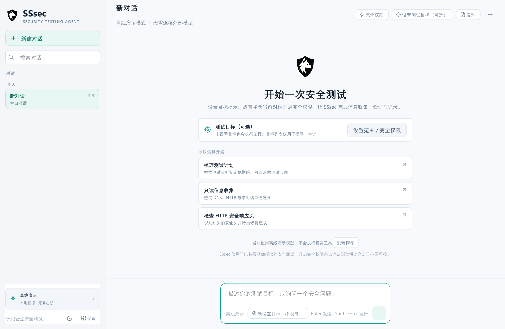
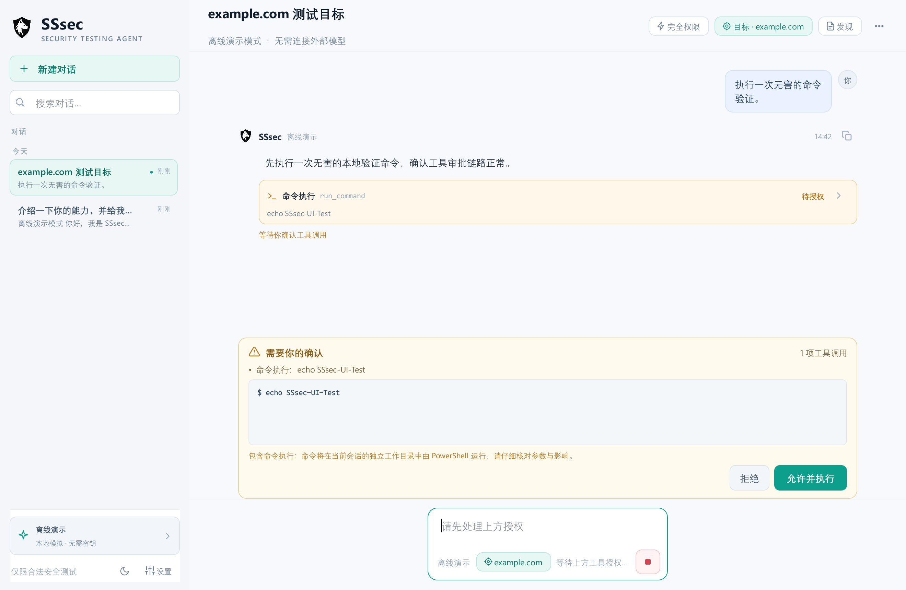
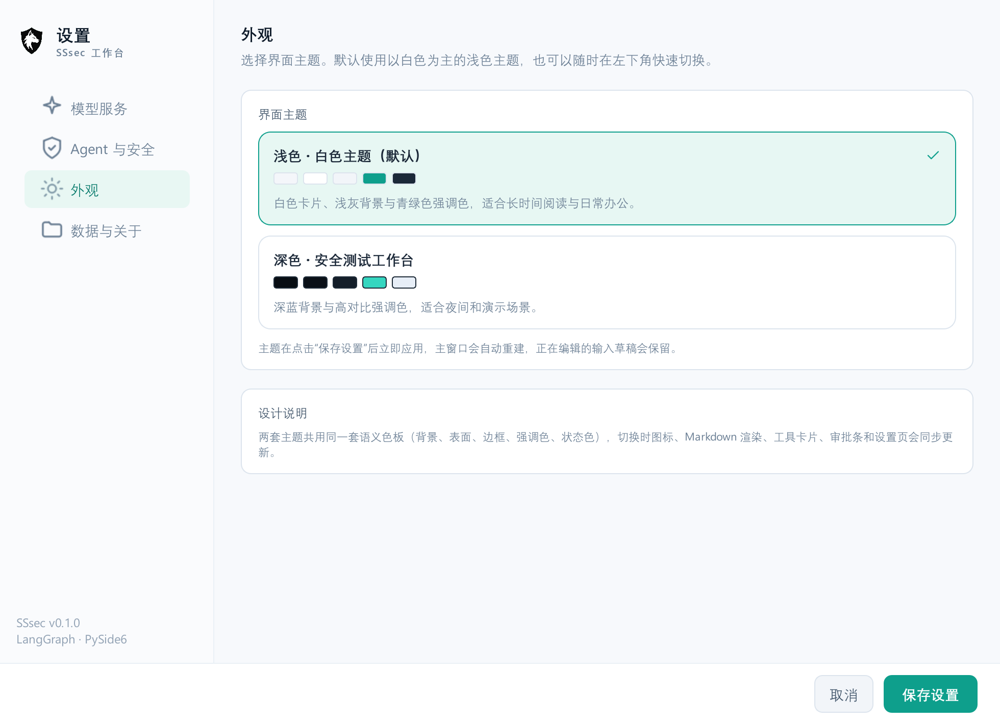
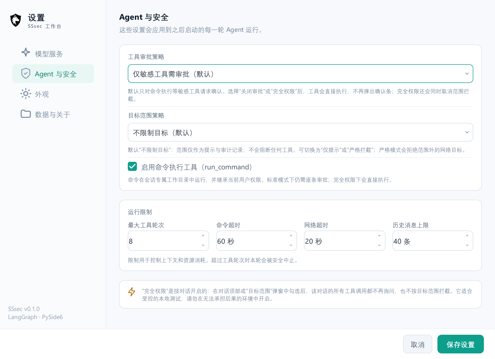
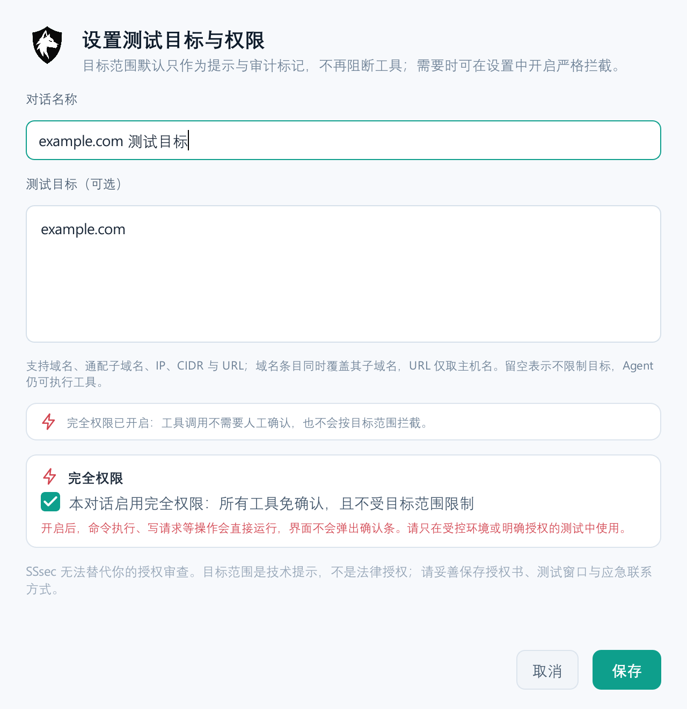
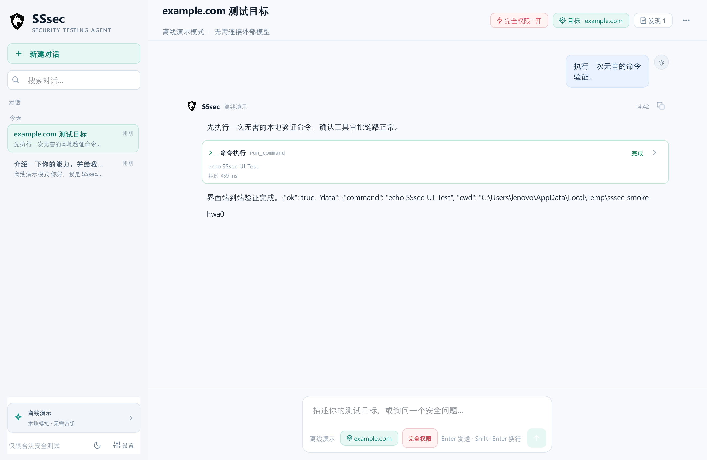
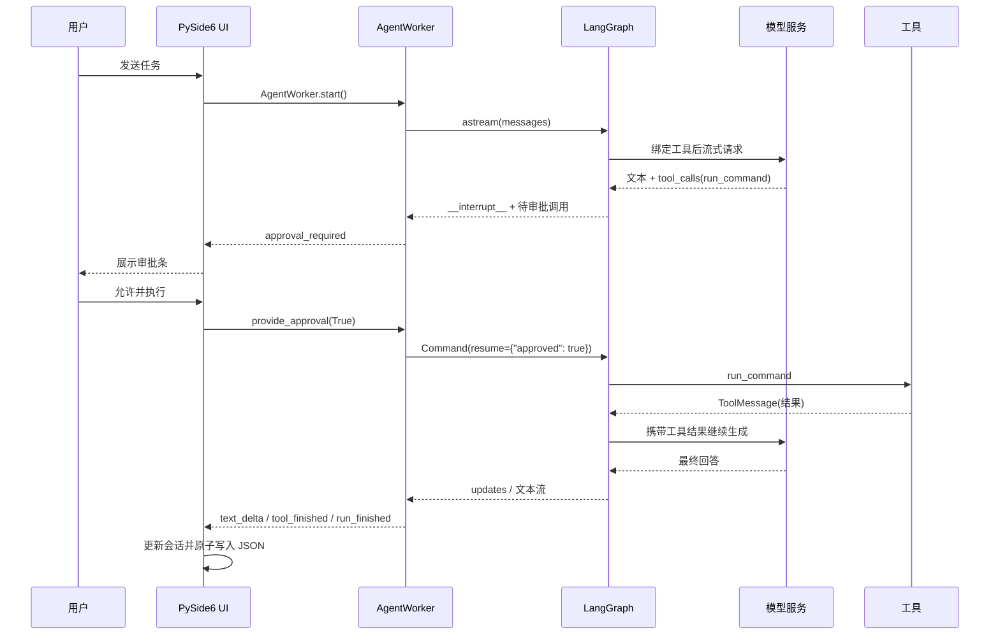
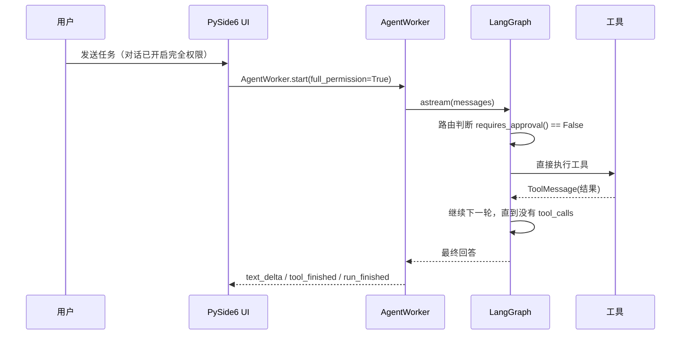

# SSsec

> **SSsec** 是一个面向授权安全测试的本地桌面 AI Agent Harness。
> 界面使用 **PySide6**，Agent 运行时基于 **LangGraph + LangChain**，模型服务、对话、工具调用、权限策略与审计全部围绕桌面工作流设计。

**当前版本：v0.1.0（首个版本）**



---

## 版本说明

v0.1.0 是 SSsec 的第一个公开版本。本版本已经打通完整的桌面 Agent 闭环：

- 多模型服务接入（OpenAI 兼容、Anthropic、离线演示）；
- 流式对话、Markdown 渲染、思考过程折叠；
- 会话持久化、搜索、草稿、窗口状态恢复；
- 目标范围提示与三种范围策略；
- 工具审批、对话级“完全权限”、全局审批策略；
- 五个内置测试工具与工具卡片、测试发现；
- 浅色 / 深色两套完整主题；
- 本地 JSON 持久化、JSONL 审计日志、DPAPI 密钥保护。

### 设计原则

1. **本地优先**：会话、审计、密钥、命令工作目录都保存在本机，SSsec 自身不上传数据。
2. **权限可切换**：目标范围与人工审批是两个独立维度，可以按对话或全局调整。
3. **全程可审计**：工具调用、参数、结果摘要、审批决定、完全权限状态都会写入审计日志。
4. **工具输出不可信**：网页、DNS、命令输出都视为数据，不当作指令执行。

---

## 1. 项目定位

SSsec 是一个**可切换权限、可审计的本地安全测试 Agent 工作台**：

- 你把测试目标、约束和任务描述交给它；
- 它通过模型规划步骤，并在需要时调用 HTTP、DNS、TCP、命令、发现记录等工具；
- 敏感操作会在界面底部请求你的确认；
- 所有工具调用与审批决定写入本地审计日志；
- 你可以随时停止、切换对话、调整权限或主题。

### 适合谁

| 角色 | 典型用途 |
| --- | --- |
| 安全工程师 | 授权范围内的资产梳理、HTTP 安全头检查、DNS/端口连通性验证、过程留痕 |
| 渗透测试人员 | 在明确授权和测试窗口内做低影响验证，把命令执行与证据记录放在同一个工作台 |
| 安全专业学生 | 在本地实验环境学习 Agent 工具调用、审批流和审计设计 |
| 工具开发者 | 以现有工具、审批、范围、审计为骨架，扩展自己的安全测试能力 |

### 与通用聊天客户端的区别

| 能力 | 通用聊天客户端 | SSsec |
| --- | --- | --- |
| 工具调用 | 通常没有或不可控 | 五个内置工具，逐个可见、可审批 |
| 权限 | 无 | 范围策略 + 审批策略 + 对话级完全权限 |
| 审计 | 无 | 每个对话独立 JSONL，记录参数与结果摘要 |
| 本地数据 | 可能在云端 | 会话、密钥、日志全部在本机 |
| 安全测试工作流 | 无 | 目标范围、测试发现、命令工作目录 |

> **授权是前提。** 目标范围是技术提示与审计标记，不是法律授权；使用前请确认你已获得目标所有者的明确许可，并遵守测试窗口、方法与当地法律。

---

## 2. 功能总览

### 2.1 界面与主题

- 三栏式桌面布局：左侧会话栏、中间聊天区、底部输入区；
- 浅色（白色主题）与深色（安全测试工作台）两套完整主题；
- 主题切换立即生效，主窗口会重建并保留输入草稿；
- 侧边栏支持会话搜索、重命名、删除、按今天/昨天/更早分组；
- 窗口大小、位置、上次打开的对话会保存；
- Windows 下标题栏颜色跟随主题（DWM）。

### 2.2 会话与权限

- 每个对话独立保存标题、目标范围、授权标记、完全权限、消息与测试发现；
- 目标范围支持域名、通配子域名、IP、CIDR、URL 与 `*`；
- 三种范围策略：`off`（默认不限制）、`warn`（仅提示）、`strict`（严格拦截）；
- 四种审批策略：仅敏感工具（默认）、所有工具、关闭审批、全局完全权限；
- 对话级“完全权限”可跳过审批并强制关闭范围拦截；
- 会话 JSON 原子写入，异常退出后会把半成品消息标记为中断。

### 2.3 模型接入

- OpenAI 兼容接口：DeepSeek、OpenAI、Qwen、Moonshot、OpenRouter、Ollama、LM Studio、vLLM 等；
- Anthropic Claude；
- 内置离线演示模型，不需要网络和 API Key；
- 每个服务可单独配置名称、模型 ID、Base URL、API Key、温度、最大输出 tokens；
- 内置“测试连接”，保存前可验证服务可用性；
- API Key 在 Windows 上使用 DPAPI 加密后写入本地配置。

### 2.4 Agent 与安全

- LangGraph 状态图：`agent → approval（可选） → tools → agent`；
- 通过 `interrupt()` / `Command(resume=...)` 实现人工审批；
- 流式文本、思考过程、工具开始/完成事件通过 Qt Signal 回到界面；
- 五个工具：HTTP 请求、DNS 查询、TCP 探测、命令执行、记录发现；
- 工具输出截断、超时、端口数/轮次上限；
- 命令在会话独立工作目录中运行，标准模式逐条审批；
- 完全权限模式跳过审批，适合受控环境连续验证。

### 2.5 本地数据与审计

- 会话：`conversations/<id>.json`；
- 审计：`audit/<id>.jsonl`，每行一个事件；
- 工作目录：`workspaces/<id>/`；
- 日志：`logs/sssec.log`，2 MB 轮转、保留 3 个备份；
- 配置：`config.json`，保存模型服务、主题与安全策略；
- 界面状态：`ui_state.json`，保存上次会话与窗口几何。

---

## 3. 界面预览

#### 启动页（默认浅色）


#### 流式对话与 Markdown


#### 工具审批（标准模式）



#### 工具执行与结果


#### 主题设置



#### 深色主题


#### 模型配置


#### Agent 与安全策略



#### 目标范围与完全权限



#### 完全权限状态



#### 测试发现


> 截图由 `scripts/ui_smoke.py` 在离屏环境中生成，使用临时数据目录，不会影响真实会话。

---

## 4. 技术架构

### 4.1 技术栈

| 层 | 技术 |
| --- | --- |
| 桌面界面 | PySide6（Qt Widgets） |
| Agent 编排 | LangGraph `StateGraph` + `interrupt()` / `Command(resume=...)` |
| 模型抽象 | LangChain `BaseChatModel`、`ChatOpenAI`、`ChatAnthropic` |
| 工具定义 | LangChain `BaseTool` / `@tool` |
| HTTP / DNS | httpx、dnspython |
| 配置与密钥 | 本地 JSON + Windows DPAPI |
| 打包 | PyInstaller（one-folder） |

### 4.2 分层

```text
┌──────────────────────────────────────────────────────────────┐
│                        PySide6 Desktop UI                    │
│  Sidebar · ChatView · Composer · SettingsDialog · ApprovalBar│
│  浅色/深色主题 · 目标范围 · 完全权限开关                          │
└───────────────────────────────┬──────────────────────────────┘
                                │ Qt Signals / Slots
┌───────────────────────────────▼──────────────────────────────┐
│                        AgentWorker (QThread)                 │
│  独立 asyncio 事件循环 · 流式事件桥接 · 审批 Future · 取消        │
└───────────────────────────────┬──────────────────────────────┘
                                │ LangGraph StateGraph
┌───────────────────────────────▼──────────────────────────────┐
│ agent 节点 ──► 是否需要审批? ──► approval 节点（可选）            │
│    │                    │                    │               │
│    │ LangChain Model    │ 不需要审批          │ interrupt()    │
│    ▼                    ▼                    ▼               │
│  ChatOpenAI /      tools 节点 ◄──────── Command(resume=...)   │
│  ChatAnthropic          │                                    │
│  DemoChatModel          ├─ http_request                      │
│                         ├─ dns_lookup                        │
│                         ├─ tcp_probe                         │
│                         ├─ run_command                       │
│                         └─ save_finding                      │
│                              │                               │
│           Scope Policy / Audit / UI Events                   │
└───────────────────────────────┬──────────────────────────────┘
                                │ JSON 持久化
┌───────────────────────────────▼──────────────────────────────┐
│ ConversationStore · SettingsStore · AuditLog · workspace     │
└──────────────────────────────────────────────────────────────┘
```

### 4.3 一次带审批的调用（标准模式）



### 4.4 一次完全权限调用



## 5. 免责声明与许可

请仅在**你拥有明确书面授权**的目标上使用。目标范围默认不拦截，完全权限默认关闭，但任何配置都不能替代授权审查。使用者应自行确保：

- 已获得目标所有者的授权；
- 测试范围、时间窗口、方法符合授权书；
- 遵守当地法律法规和职业伦理；
- 对测试造成的任何影响负责。

**项目作者不对未经授权或滥用造成的后果承担责任。**

---

**SSsec v0.1.0** · PySide6 + LangGraph + Langchain
