# SSsec

> **面向授权安全测试的本地桌面 AI Agent Harness。**
> 界面基于 **PySide6**，Agent 运行时基于 **LangGraph + LangChain**；模型服务、对话、工具调用、权限策略与审计全部围绕桌面工作流设计。

**当前版本：v0.3.0** · Linear Light / Linear Dark 双主题 · 指挥官 + 阶段子图多 Agent · 37 个执行/分析工具 · 48 张内置 

Skill · 本地 JSON / JSONL 持久化


> **仅限授权测试。** 目标范围是技术提示与审计标记，不是法律授权。使用前请确认你已获得目标所有者的明确许可，并遵守测试窗口、方法与当地法律。

---

## 版本说明

### 0.3.0（当前版本）

v0.3.0 是一次 **UI 层重构 + 流式渲染性能修复**。Agent 运行时沿用 v0.2.x 的“指挥官 + 阶段子图”架构，功能面没有缩减，重点是把桌面端做得更紧凑、更精确，并把长任务中的卡顿与白屏拆开解决。**新增 Skill 功能**，内置 48 张 Skill ，用户能自行增删。以及性能优化等升级：

- **UI 层重构为 Linear 风格**：双主题设计令牌、紧凑排版、UI 使用 Segoe UI + 微软雅黑字体栈，代码使用 Consolas 等宽字体栈；
- **流式性能修复**：33ms 合帧、流式纯文本增量 + 结束 Markdown 渲染、助手消息与工具卡片增量更新、折叠详情懒加载、发送/结束不再重建历史、滚动与保存合并；
- **修复与细节**：Windows 标题栏文字对比度、左上角精简为图标 + `SSsec`、发送者复制按钮贴近气泡并复制发送内容、助手回答复制；
- 设置页重组为模型 / Agent 与安全 / 技能库 / 外观 / 数据与关于；

- **新增技能库：**48 张内置卡、7 个分类，支持 UI 增删改、导入导出、复制内置；

- 目标驱动收尾、自动续跑、无进展升级、循环检测、证据账本压缩；

---

## 1. 项目定位

SSsec 是一个**可切换权限、可审计的本地安全测试 Agent 工作台**：

- 你把测试目标、约束和任务描述交给它；
- 它通过模型规划步骤，并按阶段调用 HTTP、DNS、TCP、端口/目录/子域扫描、编码、Crypto/二进制/文件分析、命令执行、发现记录等工具；
- 敏感操作会在界面底部等待你的确认；
- 所有工具调用、参数摘要、结果摘要与审批决定写入本地审计日志；
- 你可以随时停止、切换对话、调整权限或主题。

### 适合谁

| 角色 | 典型用途 |
| --- | --- |
| 安全工程师 | 授权范围内的资产梳理、HTTP 安全头检查、DNS/端口连通性验证、过程留痕 |
| 渗透测试人员 | 在明确授权和测试窗口内做低影响验证，把命令执行与证据记录放在同一个工作台 |
| 安全专业学生 | 在本地实验环境学习 Agent 工具调用、审批流、多 Agent 调度与审计设计 |
| 工具开发者 | 以现有工具、审批、范围、审计为骨架，扩展自己的安全测试能力 |

### 与通用聊天客户端的区别

| 能力 | 通用聊天客户端 | SSsec |
| --- | --- | --- |
| 工具调用 | 通常没有或不可控 | 分阶段工具集，按 Agent 白名单可见、可审批 |
| 权限 | 无 | 范围策略 + 审批策略 + 对话级完全权限 |
| 审计 | 无 | 每个对话独立 JSONL，记录参数与结果摘要 |
| 本地数据 | 可能在云端 | 会话、密钥、日志全部在本机 |
| 安全测试工作流 | 无 | 目标范围、测试发现、命令工作目录、阶段报告 |

---

## 2. 功能总览

### 2.1 工作区与会话

左侧是 264px 工作区栏：左上角只保留图标与 `SSsec`，下面是 `新建对话`、会话搜索（`Ctrl K`）、按今天/昨天/更早分组的会话列表、当前模型入口，以及主题和设置按钮。会话行显示标题、最后一条消息摘要、相对时间与“正在生成”指示点。

- 会话保存在本地独立 JSON 文件，自动保存每 5 秒，发送/结束/审批/记录发现时也会保存；
- 支持重命名、删除（右键菜单或右上角 `…` 菜单）；
- 删除会话会删除会话 JSON 与对应审计日志，但**不会删除** `workspaces/<id>/` 中的测试文件；
- 切换会话会保留各自的输入草稿；同一时间只允许一个对话运行 Agent。

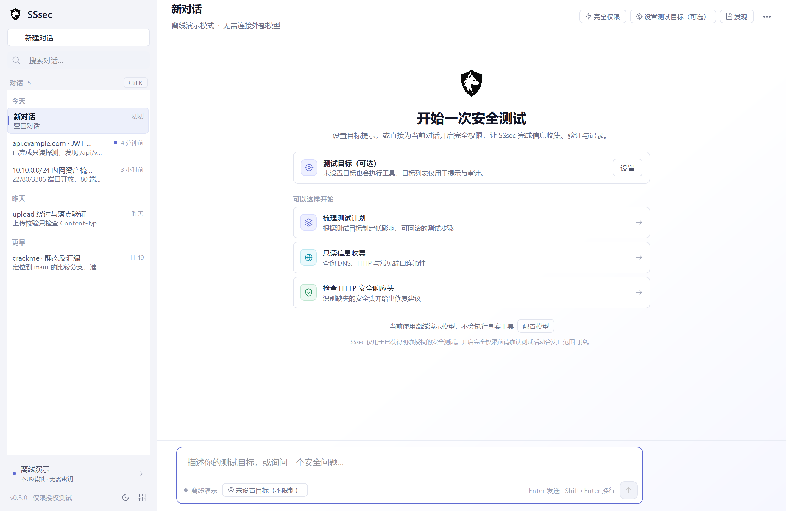

### 2.2 对话与 Markdown

- 流式输出、Markdown 渲染（标题、列表、表格、引用、代码块、分隔线）；
- 用户消息右对齐气泡，左侧紧贴“复制发送内容”按钮；助手消息带模型名、时间与“复制回答”按钮；
- 复制按钮点击后变成绿色对勾，悬停提示“已复制”；空内容会提示“暂无可复制内容”；
- 思考过程（模型 reasoning / 指挥官决策）默认折叠，点击展开；
- 长回答自动跟随滚动，用户上滚后停止自动跟随；新消息到达时若仍停留在底部则继续跟随。

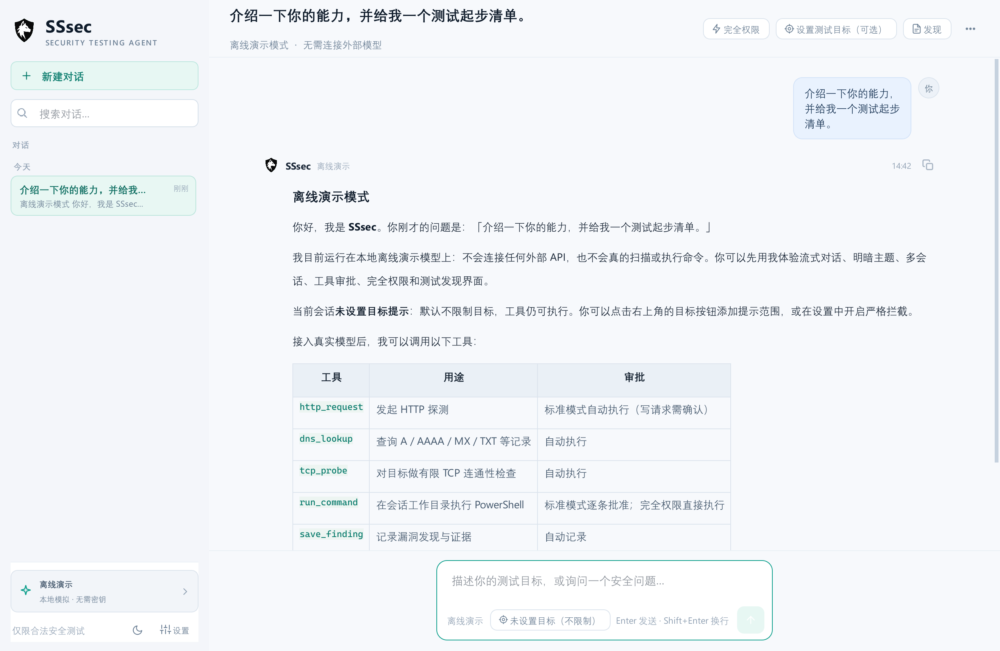

### 2.3 工具调用与详情

每次工具调用渲染为一张紧凑卡片：状态点、中文工具名、原始工具名、耗时、状态与参数摘要。展开后可查看完整参数与结果 JSON；参数/结果编辑器**首次展开时才创建**，折叠状态下不解析大 JSON。


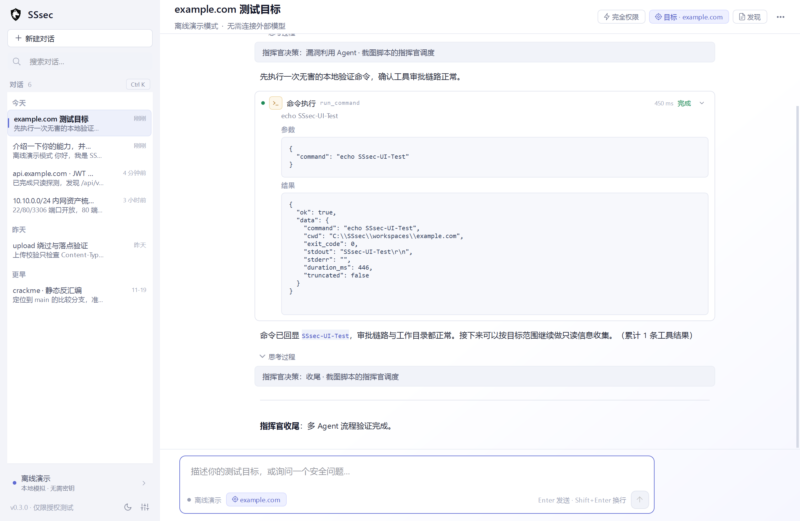

### 2.4 工具审批

当审批策略要求确认时，聊天区底部会出现审批条：

- 标题显示阶段，例如“需要确认 · 漏洞利用 Agent”；
- 列出本批工具调用（最多显示前 4 项，超出显示“另外 N 项”）；
- 若包含 `run_command`，显示命令预览与风险提示；若包含非只读 HTTP 方法，提示请求可能改变目标状态；
- 可选择“拒绝”或“允许并执行”；
- 审批以**整批工具调用**为单位，不支持逐条批准/拒绝；
- 审批决定写入审计日志（`approval_decision` / `approval_received`）。


### 2.5 测试目标与范围

目标范围用于提示与审计，默认 **不拦截** 工具。支持域名、通配子域名、IP、CIDR 与 URL；域名条目同时覆盖其子域名。

- 范围策略：`不限制目标（默认）`、`仅提示`、`严格拦截`；
- 目标列表会显示在顶部状态条、输入框状态区与空状态卡片；
- 顶部“目标”按钮可直接编辑对话名称、目标范围与完全权限；
- 保存目标时会把对话标记为“已记录授权声明”（仅用于提示词与审计，不是法律授权）。


### 2.6 完全权限

“完全权限”是 **按对话** 开启的开关：开启后该对话的所有工具调用都不再人工确认，也不按目标范围拦截。

- 顶部状态条显示红色“完全权限 · 开”；
- 输入框左下角出现红色“完全权限”标签；
- 开启前会弹出确认对话框；
- 状态在每次运行开始写入 `run_start` 审计事件，适合受控的本地测试环境；
- 设置页另有一个**全局** `完全权限` 审批模式，效果相同，影响所有对话。


### 2.7 测试发现

Agent 通过 `save_finding` 记录验证过的问题。发现列表按严重程度排序，包含目标、描述、证据与时间；每条发现保存在会话 JSON 中，不上传第三方。

严重级别：`critical`（严重）、`high`（高危）、`medium`（中危）、`low`（低危）、`info`（信息）。发现目前只支持查看，不支持在 UI 中编辑。

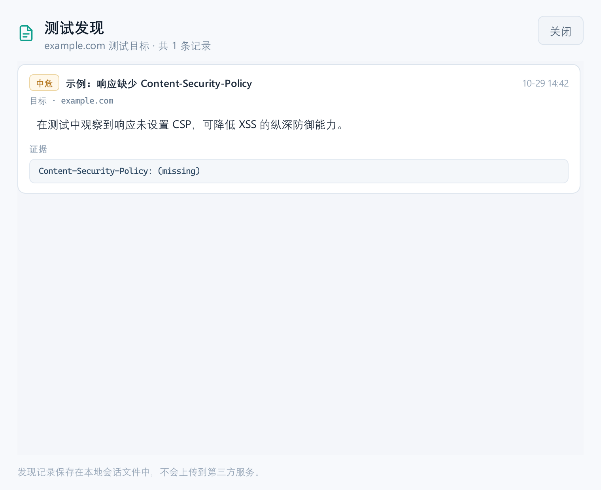

### 2.8 模型服务

支持 OpenAI 兼容接口（DeepSeek、OpenAI、Qwen、OpenRouter、Ollama、LM Studio、vLLM 等）与 Anthropic Claude，也内置离线演示模型。

- 左侧服务列表，右侧编辑表单；
- 支持“保存后设为当前模型”、API Key 显示/隐藏、温度与最大输出 tokens；
- “测试连接”会发送最小请求验证配置；
- API Key 使用 Windows DPAPI 加密后写入本地 `config.json`；非 Windows 平台退化为 Base64 编码，并在设置页明确标注。

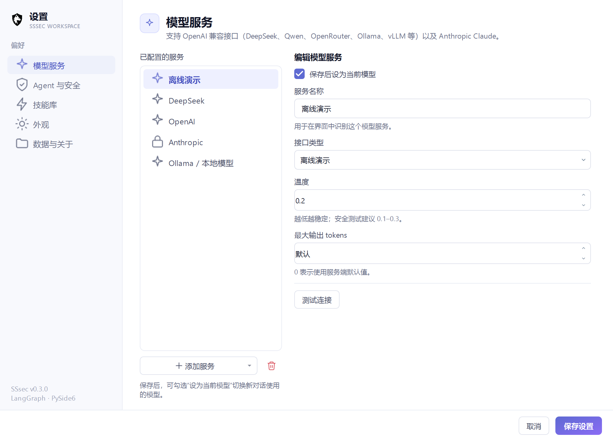

### 2.9 Agent 与安全

设置页集中管理：

- 工具审批策略与目标范围策略；
- 命令工具开关；
- 软轮次提示（只影响提示词，不硬截断阶段）；
- 安全熔断（模型持续空转时的兜底上限）；
- 自动续跑开关与上限；
- 运行熔断（分钟）；
- 命令超时、网络超时、历史消息上限；
- 技能库开关与每阶段技能上限。

循环检测阈值 `loop_guard` 默认 3（可配 1–10），设置页未暴露。当前实现中，保存设置页不会保留手改的 `loop_guard`（会回到默认 3）；如需调整，请直接改 `config.json`，并在该轮不要再保存安全设置页。


### 2.10 技能库

内置 48 张覆盖信息搜集、漏洞扫描、漏洞利用、权限提升、后渗透、逆向分析与通用流程的参考卡：

- 搜索名称/触发条件/id，按来源（全部/内置/我的/已启用）与分类筛选；
- 启用/停用、预览正文、新建/编辑/删除“我的技能”；
- 导入/导出 Markdown，复制内置技能为可编辑副本；
- 子 Agent 通过 `skill_list` / `skill_load` 按需加载，`skill_unload` 释放名额；
- 每阶段默认最多 2 张（可配 1–3）。

分类分布：

| 分类 | 数量 |
| --- | ---: |
| 信息搜集 | 8 |
| 漏洞扫描 | 18 |
| 漏洞利用 | 6 |
| 权限提升 | 4 |
| 后渗透 | 5 |
| 逆向分析 | 5 |
| 通用 | 2 |

<details>
<summary>展开 48 张内置技能卡清单</summary>

| id | 名称 | 分类 | 适用阶段 |
| --- | --- | --- | --- |
| `api-recon` | API 与隐藏端点 | 信息搜集 | recon / vuln_analysis |
| `cloud-storage` | 对象存储暴露 | 信息搜集 | recon |
| `dns-enum` | DNS 枚举 | 信息搜集 | recon |
| `info-leak` | 信息泄露与目录线索 | 信息搜集 | recon / vuln_analysis / final |
| `js-mining` | 前端 JS 挖接口 | 信息搜集 | recon / vuln_analysis / final |
| `osint-asset` | 被动资产情报 | 信息搜集 | recon |
| `recon-methodology` | 资产测绘流程 | 信息搜集 | recon / final |
| `subdomain-takeover` | 子域接管判定 | 信息搜集 | recon / vuln_analysis |
| `auth-bypass` | 认证与密钥旁路 | 漏洞扫描 | vuln_analysis / exploit / final |
| `cors` | CORS 配置错误 | 漏洞扫描 | vuln_analysis |
| `deserialization` | 反序列化识别 | 漏洞扫描 | vuln_analysis / exploit |
| `graphql` | GraphQL 测试 | 漏洞扫描 | vuln_analysis |
| `host-alias` | Host 头与静态别名 | 漏洞扫描 | vuln_analysis / exploit / final |
| `idor` | 越权与 IDOR | 漏洞扫描 | vuln_analysis / exploit |
| `include-path` | 包含与路径穿越 | 漏洞扫描 | vuln_analysis / exploit / final |
| `jwt-oauth` | JWT 与 OAuth 配置 | 漏洞扫描 | vuln_analysis |
| `open-redirect` | 开放重定向 | 漏洞扫描 | vuln_analysis |
| `php-juggling` | PHP 弱类型 | 漏洞扫描 | vuln_analysis / exploit / final |
| `race-condition` | 并发竞态 | 漏洞扫描 | vuln_analysis / exploit |
| `request-smuggling` | 请求走私判定 | 漏洞扫描 | vuln_analysis |
| `sqli` | SQL 注入探测 | 漏洞扫描 | vuln_analysis / exploit |
| `ssrf` | SSRF 与云元数据 | 漏洞扫描 | vuln_analysis / exploit |
| `ssti-jinja2` | 模板注入与黑名单绕过 | 漏洞扫描 | vuln_analysis / exploit / final |
| `upload-bypass` | 上传校验与落点 | 漏洞扫描 | vuln_analysis / exploit / final |
| `xss` | XSS 上下文与 CSP | 漏洞扫描 | vuln_analysis / exploit |
| `xxe` | XXE 外部实体 | 漏洞扫描 | vuln_analysis / exploit |
| `arbitrary-write` | 任意写与落点 | 漏洞利用 | exploit |
| `cmdi` | 命令注入 | 漏洞利用 | exploit |
| `exploit-chain` | 利用链与停止条件 | 漏洞利用 | exploit / final |
| `file-access` | 任意文件读取 | 漏洞利用 | exploit / post_exploit |
| `payload-encoding` | Payload 编码与变形 | 漏洞利用 | exploit |
| `waf-bypass` | WAF 识别与绕过 | 漏洞利用 | any |
| `container-escape` | 容器逃逸判定 | 权限提升 | post_exploit |
| `credentials` | 凭据发现 | 权限提升 | post_exploit |
| `privesc-linux` | Linux 提权枚举 | 权限提升 | post_exploit |
| `privesc-windows` | Windows 提权枚举 | 权限提升 | post_exploit |
| `cleanup-report` | 清理与报告 | 后渗透 | post_exploit / final |
| `data-exfil-readonly` | 证据采集（只读） | 后渗透 | post_exploit |
| `lateral-movement` | 横向移动评估 | 后渗透 | post_exploit |
| `persistence-check` | 持久化面识别 | 后渗透 | post_exploit |
| `webshell-basics` | Webshell 交互 | 后渗透 | post_exploit |
| `anti-debug` | 反调试识别 | 逆向分析 | reverse |
| `binary-info` | 二进制指纹与保护 | 逆向分析 | reverse |
| `crypto-classic` | 古典密码与编码 | 逆向分析 | reverse / final |
| `stego-pcap` | 隐写与流量分析 | 逆向分析 | reverse / final |
| `vm-bytecode` | VM 与字节码逆向 | 逆向分析 | reverse |
| `evidence-first` | 证据优先纪律 | 通用 | any |
| `report-writing` | 报告结构 | 通用 | final / commander |

</details>

每张卡的完整触发条件（`when`）与正文见对应文件：内置卡在 `sssec/assets/skills/<id>.md`，用户卡在数据目录的 `skills/<id>.md`。

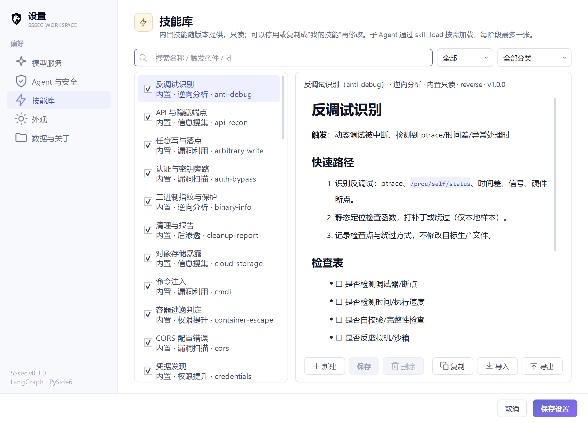

### 2.11 外观与深色主题

两套主题都遵循同一套设计令牌；切换后主窗口自动重建，保留会话与草稿。

品牌标识是盾牌 + 狼头，透明背景。高分辨率源图为 `sssec/assets/logo_mark.png`（1024×1024），`paint_brand()` 按目标尺寸等比渲染，用于窗口图标、任务栏、关于页、聊天空状态与设置页；`sssec.ico` 由 `scripts/make_icon.py` 生成，供 PyInstaller 打包使用。

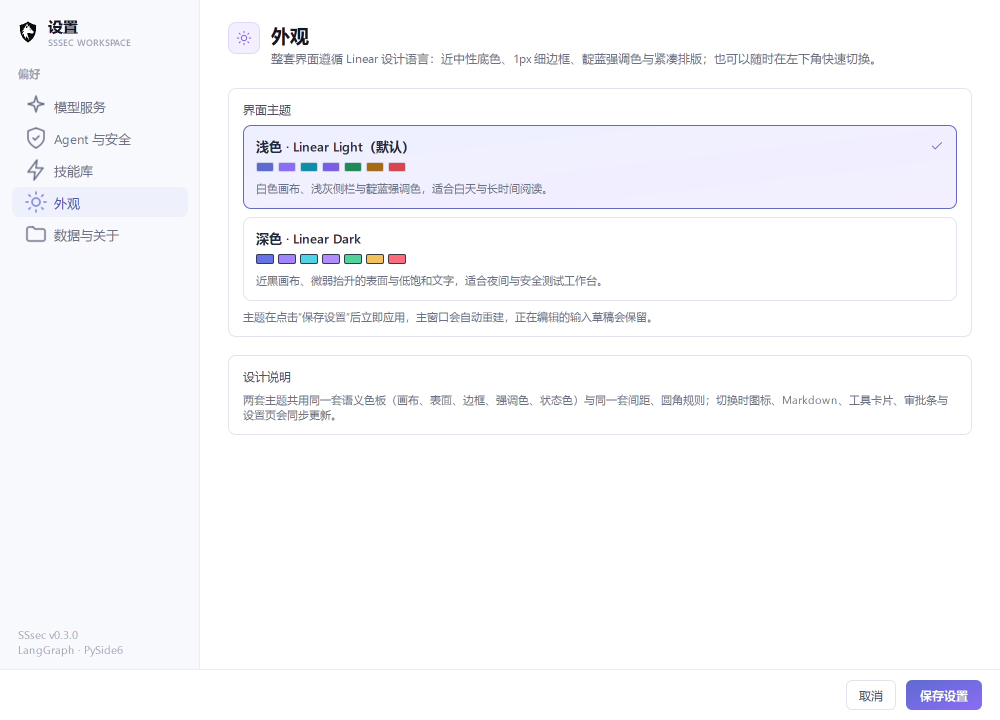

深色（Linear Dark）是这次重构的主场景：近黑画布、微弱抬升的表面、低饱和文字与靛蓝强调色。


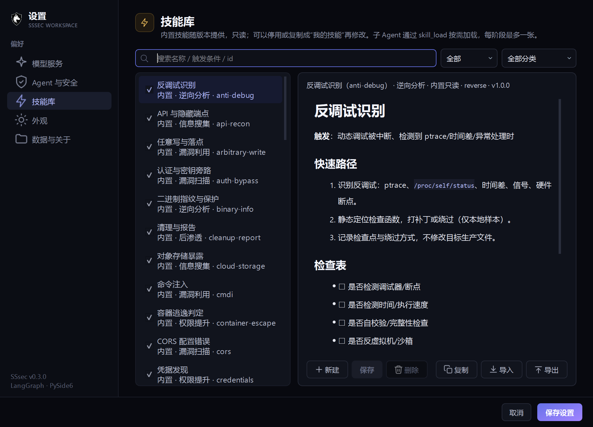

### 2.12 快捷键

| 快捷键 | 功能 |
| --- | --- |
| `Enter` | 发送消息 |
| `Shift + Enter` | 换行 |
| `Ctrl + N` | 新建对话 |
| `Ctrl + K` | 聚焦会话搜索 |
| `Ctrl + ,` | 打开设置 |
| `Esc` | 关闭对话框 / 取消弹窗（Qt 默认行为） |

---

## 3. 配置模型服务

### 3.1 服务类型

| 类型 | 说明 | Base URL 示例 |
| --- | --- | --- |
| OpenAI 兼容 | DeepSeek、OpenAI、Qwen、Moonshot、OpenRouter、vLLM、OneAPI、Ollama、LM Studio 等 | `https://api.deepseek.com/v1` |
| Anthropic | Claude 系列 | `https://api.anthropic.com` |
| 离线演示 | 本地模拟回复，不调用外部 API，也不能调用工具 | — |

Ollama 可填 `http://127.0.0.1:11434/v1`，模型名填写本地已拉取的模型。

### 3.2 内置服务档案

首次启动会写入以下五个档案（均可编辑或删除，但至少保留一个）：

| 档案 | 类型 | 模型 | Base URL |
| --- | --- | --- | --- |
| 离线演示 | `demo` | `demo-agent` | — |
| DeepSeek | `openai` | `deepseek-chat` | `https://api.deepseek.com/v1` |
| OpenAI | `openai` | `gpt-4.1-mini` | `https://api.openai.com/v1` |
| Anthropic | `anthropic` | `claude-sonnet-4-5` | `https://api.anthropic.com` |
| Ollama / 本地模型 | `openai` | `qwen2.5:7b` | `http://127.0.0.1:11434/v1` |

默认激活的是“离线演示”。

### 3.3 保存与启用

1. 点击左下角模型卡，或 `Ctrl + ,` 打开设置；
2. 选择服务，填写名称、模型 ID、Base URL、API Key；
3. 勾选“保存后设为当前模型”，或保存后在列表中切换；
4. 点击“测试连接”确认可用，再点击“保存设置”；
5. 编辑任意字段会自动把该服务标记为当前模型（仍以“保存设置”为准）。

### 3.4 模型能力要求

- Agent 工具链要求模型支持 **function / tool calling**；不支持工具调用的模型只能用于普通对话；
- 建议选择支持 **流式输出 + tool calls** 的模型；
- DeepSeek thinking 模型会自动启用 `reasoning_content` 保留与回传；
- 使用 OpenAI 兼容的本地服务时，如果 Base URL 指向 `localhost`、回环地址、私有网段或 `.local`，可以留空 API Key；
- Anthropic 服务始终需要 API Key。

### 3.5 测试连接

“测试连接”会用当前表单构建模型，发送一次最小请求（“只回复：SSsec 连接正常”），并显示延迟与回复片段。常见错误会被翻译成可读提示：401/403、404、429、连接/超时、TLS、工具不支持等。

### 3.6 密钥安全

- API Key 只写入本地 `config.json`；
- Windows 上使用当前用户的 **DPAPI** 加密，换用户或换机器通常无法解密；
- macOS / Linux 没有系统钥匙串集成时退化为 Base64 编码，界面会显示“Base64 本地编码”而不是“已强加密”；
- 界面中默认以密码形式显示，点击“显示”才明文展示；
- 日志与错误信息会尝试用 `***` 替换 API Key，但不要把日志发给不可信对象。

---

## 4. 技术架构

### 4.1 技术栈

| 层                | 技术                                                         |
| ----------------- | ------------------------------------------------------------ |
| 桌面界面          | PySide6（Qt Widgets）                                        |
| 多 Agent 编排     | LangGraph `StateGraph` + 子图 + `interrupt()` / `Command(resume=...)` |
| Supervisor        | 指挥官节点：模型输出 JSON 决策，只路由、不执行工具           |
| 模型抽象          | LangChain `BaseChatModel`、`ChatOpenAI`、`ChatAnthropic`     |
| DeepSeek thinking | `ReasoningChatOpenAI` 子类：保留并回传非标准 `reasoning_content` |
| 工具定义          | LangChain `BaseTool` / `@tool`，按阶段分发给子 Agent         |
| HTTP / DNS / TLS  | httpx、dnspython、ssl                                        |
| 配置与密钥        | 本地 JSON + Windows DPAPI                                    |
| 打包              | PyInstaller（one-folder）                                    |

### 4.2 分层

```text
┌──────────────────────────────────────────────────────────────┐
│                        PySide6 Desktop UI                    │
│  Sidebar · ChatView · Composer · SettingsDialog · ApprovalBar│
│  浅色/深色主题 · 目标范围 · 完全权限开关                       │
└───────────────────────────────┬──────────────────────────────┘
                                │ Qt Signals / Slots
┌───────────────────────────────▼──────────────────────────────┐
│                        AgentWorker (QThread)                 │
│  独立 asyncio 事件循环 · 流式事件桥接 · 审批 Future · 取消     │
└───────────────────────────────┬──────────────────────────────┘
                                │ LangGraph
┌───────────────────────────────▼──────────────────────────────┐
│ commander（Supervisor，只路由，不执行工具）                   │
│   │  输出 {next, task, reason, summary}                      │
│   ├─► recon 子图 ────────────┐                               │
│   ├─► vuln_analysis 子图 ────┤                               │
│   ├─► exploit 子图 ──────────┤──► report ──► commander        │
│   ├─► post_exploit 子图 ─────┘                               │
│   └─► finalize（finish）                                      │
│                                                              │
│ 每个子图：agent → approval? → tools → agent → … → handoff/END│
│ 工具按阶段划分；子图 interrupt 会冒泡到父图                    │
└───────────────────────────────┬──────────────────────────────┘
                                │ JSON 持久化
┌───────────────────────────────▼──────────────────────────────┐
│ ConversationStore · SettingsStore · AuditLog · workspace     │
└──────────────────────────────────────────────────────────────┘
```

### 4.3 阶段子图内部的一次带审批调用（保守模式）

> 下图只画单个阶段子图内部；指挥官的调度与交接见 4.5。

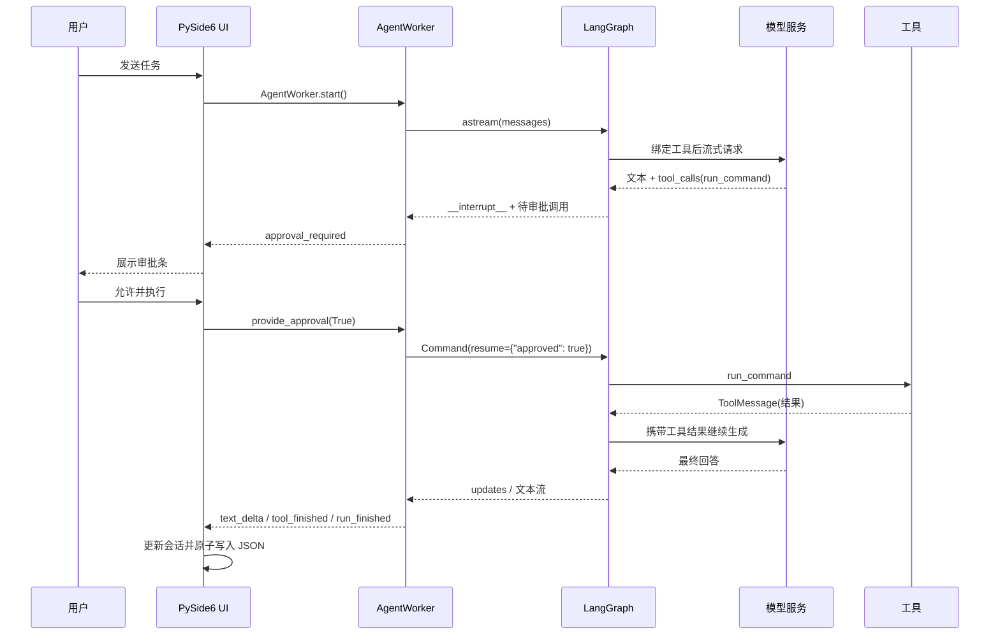

### 4.4 阶段子图内的一次完全权限调用

> 下图只画单个阶段子图内部；指挥官的调度与交接见 4.5。

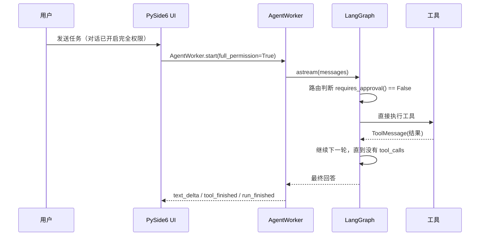

### 4.5 多 Agent 调度与交接

这是本版本新增的核心结构：

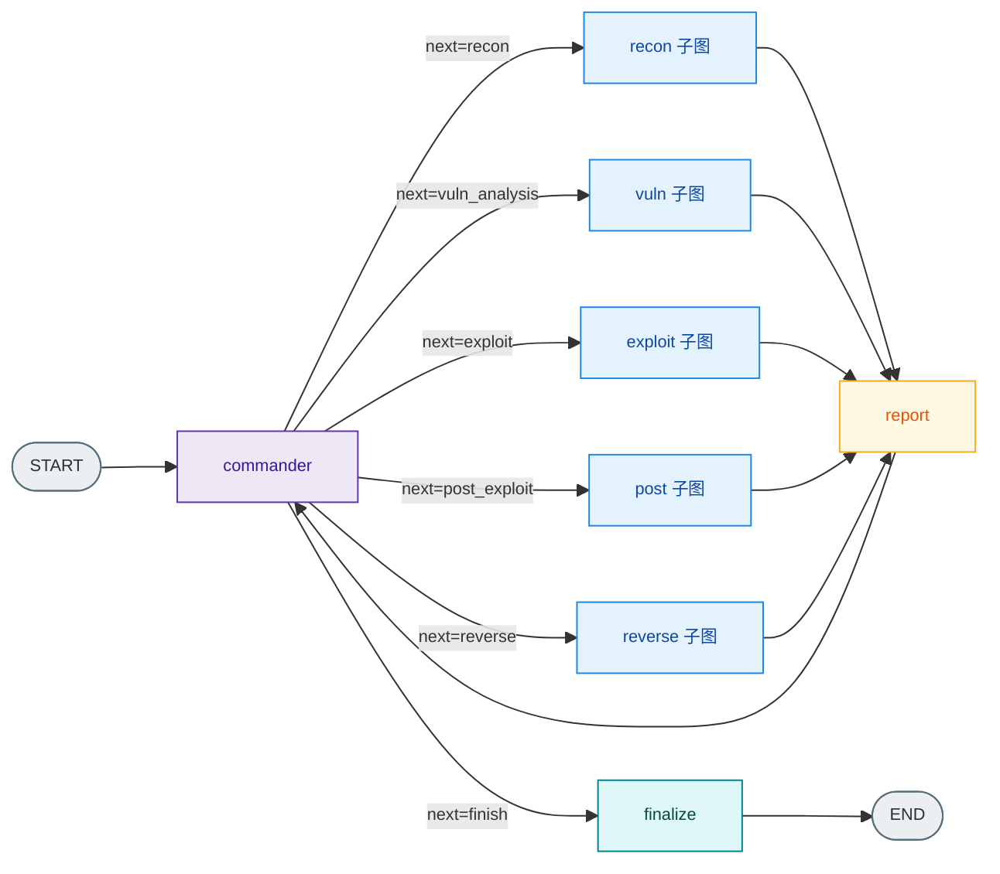

**职责边界**

| 角色            | 职责                                                         | 核心工具                                                     |
| --------------- | ------------------------------------------------------------ | ------------------------------------------------------------ |
| `commander`     | 读取总目标、阶段报告、交接建议，输出 `{next, task, reason, summary}`；只路由，不做渗透 | 无                                                           |
| `recon`         | 资产发现、HTTP 指纹、子域/端口/目录、爬虫、WHOIS/TLS、DNS 区域传送、API 文档发现 | `http_probe`、`http_request`、`api_discover`、`port_scan`、`subdomain_enum`、`dir_scan`、`web_crawl`、`dns_zone_transfer`、`whois_lookup`、`tls_certificate` |
| `vuln_analysis` | 参数/CORS/JWT/WAF/LFI/SSRF/API 探测、源码秘密扫描、Crypto/二进制/文件分析 | `http_request`、`http_raw`、`http_upload`、`security_headers`、`param_fuzz`、`lfi_probe`、`ssrf_probe`、`api_discover`、`cors_check`、`jwt_analyze`、`waf_detect`、`artifact_scan`、`codec`、`crypto_workshop`、`binary_info`、`disassemble`、`file_analyze`、`run_command` |
| `exploit`       | 在授权范围内做低影响验证/利用，证明影响后收敛                | `http_request`、`http_raw`、`http_upload`、`security_headers`、`param_fuzz`、`lfi_probe`、`ssrf_probe`、`api_discover`、`payload_forge`、`codec`、`tcp_exchange`、`binary_info`、`disassemble`、`run_command`、`workspace_write` |
| `post_exploit`  | 权限与影响评估、Webshell/证据整理、flag 提取、压缩包分析     | `run_command`、`webshell_client`、`archive_extract`、`artifact_scan`、`file_analyze`、`disassemble`、`http_request`、`http_raw`、`workspace_write` |
| `reverse`       | 二进制/固件逆向、静态反汇编、校验逻辑与授权算法分析          | `binary_info`、`disassemble`、`file_analyze`、`crypto_workshop`、`codec`、`run_command`、`tcp_exchange`、`archive_extract`、`artifact_scan`、`flag_hunt` |
| `final`         | 最后汇总全部证据、重新建模并做最后突破；不绑定 handoff       | 全部 37 个工具                                               |

**角色、工具白名单与轮次**

| 角色            | 标签               | 主要职责                                                     | 白名单条目 |   基础轮次 |
| --------------- | ------------------ | ------------------------------------------------------------ | ---------: | ---------: |
| `commander`     | 指挥官             | 只做路由，输出下一步、任务简报与收尾摘要                     |          0 |   16（软） |
| `recon`         | 信息收集 Agent     | HTTP 指纹、端口、子域、目录、爬虫、WHOIS/TLS、DNS 区域传送   |         15 |          6 |
| `vuln_analysis` | 漏洞分析 Agent     | 参数/CORS/JWT/WAF/SSRF/LFI/API 探测、源码秘密扫描、Crypto/二进制分析 |         23 |          6 |
| `exploit`       | 漏洞利用 Agent     | HTTP/原始请求/上传、Payload 生成、TCP 交互、命令执行与二进制利用 |         19 |          8 |
| `post_exploit`  | 后渗透 Agent       | Webshell 命令、证据整理、flag 提取、压缩包分析、源码秘密扫描 |         13 |          6 |
| `reverse`       | 逆向分析 Agent     | ELF/PE/固件逆向、静态反汇编、校验逻辑与授权算法分析          |         14 |          8 |
| `final`         | 最终汇总突破 Agent | 汇总前面所有证据、重新建模并做最后突破的全工具 Agent         | 全部 37 个 |         20 |
| `single`        | 单 Agent 解题      | TSEC 快速模式：全部工具、无指挥官、无 handoff                | 全部 37 个 | 全局软预算 |

### 4.6 Skill 运行时

```text
指挥官 prompt ── 按分类的紧凑索引（id 列表，7 行）
      │  task 可写“建议先 skill_load(<id>)”
      ▼
  worker ── skill_list 看清单/分类 → skill_load(id) 取正文（≤6000 字符）
      │        每阶段默认 2 张；名额满可 skill_unload 换卡
      ▼
  report ── skills: [id] 回到指挥官
```

- 技能工具（`skill_list` / `skill_load` / `skill_unload`）对所有阶段自动可用，不占用各阶段白名单；
- 加载上限由 `skill_max_loaded` 控制（默认 2）；
- 超出上限时返回明确错误，并写 `skill_blocked` 审计；
- 技能正文只注入一次（作为工具结果），不重复进系统提示；
- 技能是参考，与工具证据冲突时以证据为准并记录冲突点；
- 审计记录 `skill_loaded` / `skill_unloaded` / `skill_blocked`，`worker_report` 带 `skills`。


## 5. 工具与权限边界

### 工具清单

**信息收集（recon）**

| 工具                | 作用                                                      | 关键限制                   |
| ------------------- | --------------------------------------------------------- | -------------------------- |
| `http_probe`        | 单 URL 指纹：状态、标题、技术栈、Server、Cookie、重定向链 | 响应体最多 120000 字符     |
| `dns_lookup`        | A/AAAA/CNAME/MX/TXT/NS/SOA/CAA/PTR                        | 最多 50 条答案             |
| `dns_zone_transfer` | 对 NS 尝试 AXFR 区域传送                                  | 最多 4 个 NS、300 条记录   |
| `port_scan`         | TCP 端口扫描 + 服务猜测 + 可选 banner                     | 单次最多 500 端口，并发 64 |
| `subdomain_enum`    | 内置/自定义字典子域枚举 + 泛解析过滤                      | 最多 500 个候选，并发 20   |
| `dir_scan`          | `.git`、`.env`、admin、swagger、backup 等路径发现         | 最多 300 个路径，并发 10   |
| `web_crawl`         | 链接/表单/JS/API 端点提取                                 | 最多 20 页、20 个 JS       |
| `api_discover`      | Swagger/OpenAPI/GraphQL/Actuator/API 路径发现             | 最多 40 个路径             |
| `whois_lookup`      | IANA + refer 的 WHOIS 信息                                | 响应截断 12000 字符        |
| `tls_certificate`   | 证书主题/颁发者/有效期/SAN/协议/套件                      | 网络超时                   |

**漏洞分析（vuln_analysis）**

| 工具               | 作用                                                   | 关键限制                                    |
| ------------------ | ------------------------------------------------------ | ------------------------------------------- |
| `http_request`     | 完整方法/头/Cookie/Body 请求                           | 重定向逐跳校验，响应体 256 KiB              |
| `security_headers` | CSP/HSTS/XFO/Cookie/信息泄露检查                       | 单次 GET                                    |
| `param_fuzz`       | 单参数 XSS/SQLi/SSTI/LFI/CMD/SSRF/跳转探测             | 最多 30 个 payload，比较状态/长度/反射/耗时 |
| `lfi_probe`        | 路径穿越/LFI 探测（Linux/Windows/flag/php filter）     | 最多 12 个 payload                          |
| `ssrf_probe`       | 云 metadata/localhost/file/gopher SSRF 探测            | 最多 12 个 payload                          |
| `api_discover`     | API 文档/Actuator/GraphQL 探测                         | 最多 40 个路径                              |
| `cors_check`       | ACAO 反射、通配符 + Credentials、预检                  | GET + OPTIONS                               |
| `jwt_analyze`      | JWT 解码、alg=none、HMAC 校验、常见弱密钥              | 输入 20000 字符                             |
| `waf_detect`       | WAF 指纹与响应差异                                     | 5 个探针                                    |
| `artifact_scan`    | 源码 sink / secret 扫描                                | 最多 300 文件、单文件 2 MB                  |
| `codec`            | 编解码/哈希（base64/url/hex/rot13/caesar/morse…）      | 输入 40000 字符                             |
| `crypto_workshop`  | XOR/Caesar/RSA/hash/freq 基础分析                      | 输入/字典有上限                             |
| `binary_info`      | ELF/PE 架构、PIE/NX/RELRO/Canary、字符串               | 最多 4 MB                                   |
| `disassemble`      | ELF/PE `.text` 静态反汇编（x86/x86_64/ARM/ARM64/MIPS） | 单次 1–200 条指令                           |
| `file_analyze`     | magic/哈希/熵/字符串/hexdump/ZIP 条目                  | 最多 2 MB                                   |

**漏洞利用（exploit）**

| 工具              | 作用                                        | 关键限制                           |
| ----------------- | ------------------------------------------- | ---------------------------------- |
| `http_request`    | 常规 HTTP 验证                              | 同上                               |
| `http_raw`        | 原始 HTTP/1.1 请求（畸形、分块、走私）      | 请求 100000 字符，响应 200000 字节 |
| `http_upload`     | multipart 文件上传                          | 文件 5 MB                          |
| `lfi_probe`       | 文件读取验证                                | 同上                               |
| `ssrf_probe`      | 内网/云 metadata 验证                       | 同上                               |
| `api_discover`    | API 入口发现                                | 同上                               |
| `payload_forge`   | SQLi/SSTI/LFI/CMD/XSS/SSRF/XXE/跳转 payload | 每组 4–6 条，支持编码              |
| `codec`           | 编码/哈希                                   | 同上                               |
| `tcp_exchange`    | TCP/TLS 发送与读取（pwn/AWD）               | 发送 2 MB，接收 200 KB             |
| `binary_info`     | ELF/PE 保护与字符串                         | 同上                               |
| `disassemble`     | 反汇编定位校验/关键调用                     | 同上                               |
| `run_command`     | PowerShell / bash 命令                      | 命令 4000 字符，默认 60 秒         |
| `workspace_write` | 写 exploit 脚本/证据                        | 20 万字符                          |

**后渗透（post_exploit）**

| 工具              | 作用                       | 关键限制                       |
| ----------------- | -------------------------- | ------------------------------ |
| `run_command`     | 只读系统/权限检查          | 同上                           |
| `webshell_client` | GET/POST webshell 命令执行 | 输出 12000 字符                |
| `archive_extract` | zip/tar/gz/bz2/xz 安全解压 | 500 条目、100 MB、拒绝目录穿越 |
| `artifact_scan`   | 源码/配置 secret 扫描      | 同上                           |
| `file_analyze`    | 证据文件分析               | 同上                           |
| `disassemble`     | 二进制/固件取证辅助        | 同上                           |
| `workspace_write` | 保存证据/报告              | 同上                           |

**逆向专项（reverse，可选）**

| 工具              | 作用                              | 关键限制                   |
| ----------------- | --------------------------------- | -------------------------- |
| `binary_info`     | ELF/PE/固件基础信息、保护、字符串 | 最多 4 MB                  |
| `disassemble`     | 静态反汇编 `.text`，支持多架构    | 1–200 条/次                |
| `file_analyze`    | magic/熵/字符串/hexdump           | 最多 2 MB                  |
| `crypto_workshop` | 校验算法/编码/密钥分析            | 输入/字典有上限            |
| `codec`           | 编解码/哈希                       | 输入 40000 字符            |
| `run_command`     | 本地运行求解脚本/调试命令         | 命令 4000 字符，默认 60 秒 |
| `tcp_exchange`    | 与远端二进制服务交互              | 发送 2 MB，接收 200 KB     |
| `archive_extract` | 固件/压缩包安全解压               | 500 条目、100 MB           |

**所有阶段共享**

| 工具                                | 作用                                     |
| ----------------------------------- | ---------------------------------------- |
| `save_finding`                      | 记录测试发现                             |
| `handoff`                           | 把控制权交回指挥官（`final` 不使用）     |
| `flag_hunt`                         | 从文本/工作区提取 `flag{...}`/`CTF{...}` |
| `workspace_list` / `workspace_read` | 查看工作区文件                           |


## 6. 免责声明与许可

请仅在**你拥有明确书面授权**的目标上使用。目标范围默认不拦截，完全权限默认关闭，但任何配置都不能替代授权审查。使用者应自行确保：

- 已获得目标所有者的授权；
- 测试范围、时间窗口、方法符合授权书；
- 遵守当地法律法规和职业伦理；
- 对测试造成的任何影响负责。

**项目作者不对未经授权或滥用造成的后果承担责任。**

---

**SSsec v0.3.0** · PySide6 + LangGraph
